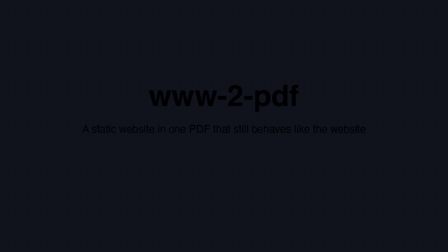
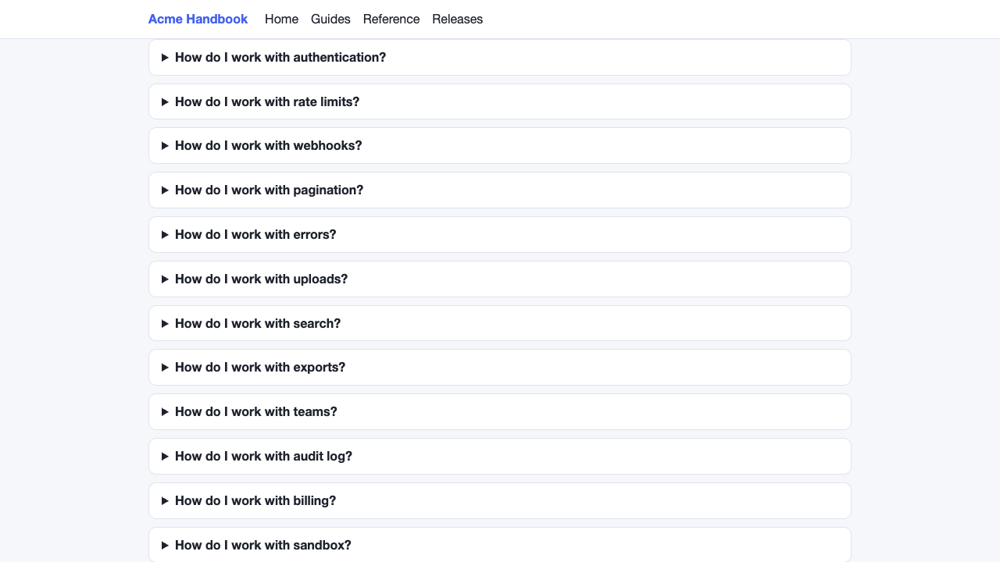
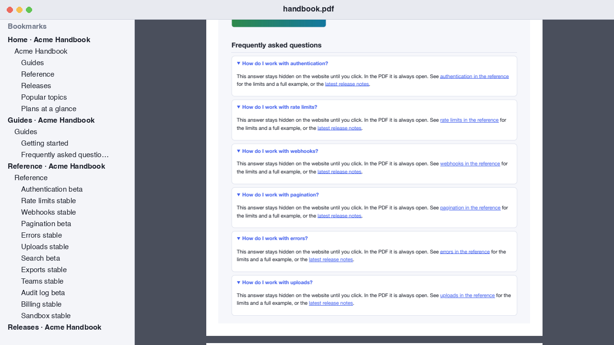

<div align="center">

# www-2-pdf

**Turn a static website into one PDF that still behaves like the website.**

Click a link and you jump inside the file. Press back and you return. No internet required.


[](LICENSE)
[](https://github.com/borovetsav/www-2-pdf/releases/latest)

[](docs/demo.mp4)

<sub>A 30-second demo on a made-up site, animated from the real PDF. <a href="docs/demo.mp4">Watch the sharper MP4</a>.</sub>

</div>

## Install

Download the one script and run it:

```bash
curl -LO https://github.com/borovetsav/www-2-pdf/releases/latest/download/www2pdf.py
python3 www2pdf.py https://example.com/ -o ~/Desktop/site.pdf
```

That is the whole setup. On the first run the script installs its own dependencies into `~/.www2pdf`, with no `sudo`, Homebrew or wget.

If www-2-pdf saved you a website, a ⭐ helps other people find it.

## When it helps

You have a static site and want it as a single file that keeps working:

- **Documentation** to read on a plane or hand to a client
- **Research notes and knowledge bases** with many cross-references between pages
- **Project and course sites** to archive before they go offline
- **Reports and catalogs** to send as one attachment instead of a link

## Screenshots

<table>
<tr><th>On the website: answers hidden behind clicks</th><th>In the PDF: everything open, with bookmarks</th></tr>
<tr><td></td><td></td></tr>
</table>

## What you get

Printing a site page by page gives you a pile of files that lose their links and hide half their content. Tools that convert a whole site tend to give you either its look or working internal links. This one aims for both:

| On the website | In the PDF |
|---|---|
| Each page | A section, with a nested bookmark outline of `h1`–`h3` headings and disclosures |
| `page.html` | A jump to the start of that section |
| `page.html#id` and `#id` | A jump to that exact element, not just its page |
| External links | Regular web links |
| Links to the site's own images | A jump to the full image in an "Images" appendix |
| Collapsed `<details>`, `aria-controls` panels, tabs, `.collapse` | Expanded, with the text kept |
| Scrollable boxes and wide tables | Printed in full, nothing cut off |
| Colors, backgrounds, badges, fonts | Same as on screen, always in the light theme |
| Sticky and fixed headers | Printed once, never covering the text |
| A link's `title` tooltip | Stored in the link's `/Contents` |

## How it works


Every internal link becomes an explicit `[page /XYZ 0 y null]` destination. Nothing stays a named destination, so identical ids on different pages cannot collide, and PDF viewers record each jump in their history.

Chromium writes anchor coordinates inaccurately: as if the scale were 1, with margin handling that depends on the version, and it shrinks pages wider than the sheet. So the correction is not hard-coded. Two probe anchors on every page compare the recorded position with the real one, and the jumps stay accurate if Chromium's behavior changes. If the measurement fails, the summary warns about it.

## Usage

```bash
python3 www2pdf.py URL -o OUTPUT.pdf [options]
```

| Option | Description | Default |
|---|---|---|
| `-o FILE` | Where to save the PDF | required |
| `--scale 0.75` | Print scale, 0.1–2. Lower means smaller text; a high scale can trigger the site's mobile layout | `0.75` |
| `--paper A4\|Letter` | Paper size | `A4` |
| `--margin 8` | Margins in mm | `8` |
| `--max 500` | Limit on the number of site pages | `500` |
| `--long-pages` | One long PDF sheet per site page | off |
| `--no-images` | Skip the images appendix; links to images stay web links | off |
| `--chrome PATH` | Path to a Chromium-based browser | auto-detected |
| `--timeout 120` | Page load timeout in seconds | `120` |
| `--report FILE.json` | Save a report as JSON | off |

The script uses an installed Chrome, Edge, Brave or Yandex browser, and downloads Chromium if it finds none. It needs Python 3.9 or newer. To install dependencies elsewhere, set `WWW2PDF_VENV`; a folder that contains anything other than a virtual environment's own files is never deleted.

Every run ends with a summary: sheets, expanded `<details>`, anchored links, and each anchor that does not exist on the site.

## Going back and forward

| Viewer | Back | Forward |
|---|---|---|
| Preview | `⌘[` | `⌘]` |
| Acrobat | `⌘←` | `⌘→` |
| Firefox | Browser back button | Browser forward button |

In Preview, open the bookmarks with **View → Table of Contents**.

## Limitations

- **Static content only.** JavaScript menus that need a click are not pressed. Only the disclosures listed above are expanded.
- **Pages must be linked.** The crawl follows `<a href>` and `<area href>`, so a page nothing links to is not included.
- **Image-map areas are not clickable.** `<area>` regions do not become links in the PDF; the summary lists them.
- **Missing anchors go to the section start,** as in a browser, and the summary lists them. With duplicate ids, a jump goes to the first element.
- **Only images are embedded.** Links to the site's other files, such as PDFs and archives, stay web links and appear in the summary.
- **Very wide pages get smaller text.** They print at a lower scale so nothing is cut off, and the summary says so.
- **`overflow: hidden` is respected.** Whatever a site hides this way stays as it is on screen and is not in the PDF.
- **Tooltips vary by viewer.** Not every viewer displays `/Contents`.
- **Very long pages may split.** With `--long-pages`, a page taller than the PDF limit of about 5 m takes several sheets.

## Testing

```bash
tests/run_all.sh                      # mock site at scale 0.5, 0.75, 1 and 2, long pages, Letter
tests/run_all.sh https://example.com/ # also a real site and a PDFKit check on macOS
```

| Script | What it does |
|---|---|
| `tests/make_mock.py` | Generates a mock site: 4 pages, 160 entries, 120 sources, hidden markers |
| `tests/verify.py` | Takes its expectations from the site itself, independently of `www2pdf.py`, and checks every link, all text, bookmarks and sheets |
| `tests/test_mutations.py` | Damages PDFs and sites on purpose and requires the verifier to notice each time |
| `tests/test_edges.py` | Runs tricky sites: SVG links, `<base>`, `<a name>`, redirects, hanging images and fonts, unusual ids |
| `tests/pdfkit_check.py` | Follows links, back and forward using PDFKit, the engine behind Preview (macOS only) |

The verifier does not check text color, so review the visual result yourself. Test dependencies install into `~/.www2pdf-tests`.

## License

[MIT](LICENSE)
